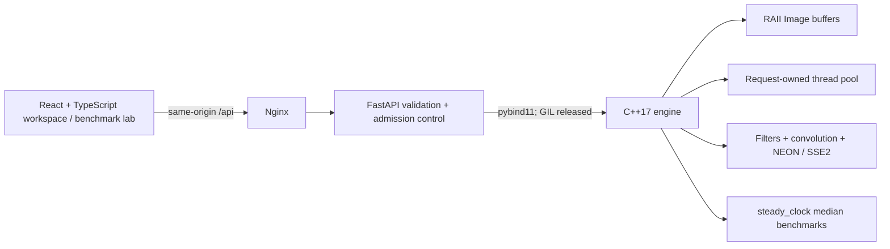

# Image Processing Engine

A native C++17 image processing workbench with measurable sequential, parallel, and optimized execution. FastAPI calls a compiled pybind11 module; React renders the results and visualizes timings. Every pixel operation runs in C++.

## Run with Docker

```bash
docker compose up --build
```

Open **http://localhost:3000**. The frontend proxies `/api` over a private Compose network; the backend has no host port. Initial builds require internet for dependencies. Both runtime services use unprivileged users. Docker builds the extension for the target architecture, with no `-march=native` or GPU requirement.

```bash
docker compose up --build -d --wait
docker compose logs -f
docker compose down
```

Optional: copy `.env.example` to `.env` and change `IMAGE_PROCESSING_ENGINE_PORT`.

## Architecture



- **Engine:** STL buffers, a reusable task queue, clamped convolution, separable Gaussian blur, SIMD inversion, independently usable CMake library and benchmark executable.
- **Backend:** Python 3.12 in Docker, typed parameter validation, bounded uploads and two concurrent POST requests, native decoding and encoding through stb.
- **Frontend:** React, TypeScript, Vite, Tailwind CSS, a shadcn-style Radix button component, Lucide, and Recharts. Upload, adjustable filters, before/after slider, zoom/fit, PNG download, session history, and a separate benchmark dashboard.
- **Checks:** GoogleTest, native-backed API tests, ASan/UBSan and ThreadSanitizer, Playwright browser tests, and GitHub Actions.

## Algorithms and semantics

| Filter | Implementation | Parameters |
| --- | --- | --- |
| Grayscale | `0.2126 R + 0.7152 G + 0.0722 B` | None |
| Brightness / contrast | `(value - 127.5) × contrast + 127.5 + brightness` | Brightness −255…255, contrast 0…4 |
| Gaussian blur | Normalized 2D kernel; optimized mode uses two 1D passes | Odd kernel 1…31, sigma 0.1…20 |
| Sobel edges | Horizontal/vertical gradients of floating luminance, clamped magnitude | None |
| Sharpen | `[0,-1,0; -1,5,-1; 0,-1,0]` convolution | None |
| Resize | Integer nearest-neighbor or pixel-center bilinear interpolation | Width/height, interpolation |
| Invert | `255 - RGB`; contiguous SIMD in optimized mode | None |

RGB and RGBA remain RGB and RGBA. Grayscale inputs expand to RGB; grayscale with alpha expands to RGBA. All filters preserve each source pixel's alpha, except resizing interpolates all four channels. Borders replicate the nearest valid pixel. Output is rounded and saturated to 0…255. Non-resize operations preserve dimensions. Inputs are PNG/JPEG; output is always 8-bit PNG. EXIF orientation and color profiles are not applied.

Optimized mode contains specialized paths for **Gaussian** and **invert**. Other filters use the multithreaded kernel, explicitly disclosed in the UI. NEON is part of the ARM64 baseline and SSE2 is part of x86-64; other targets fall back to scalar code. No optional CPU instruction extension is assumed.

## Local development

Requires a C++17 compiler, Python 3.12 or newer, and Node 22.12+ (or supported newer Node). On macOS install Xcode command-line tools; Linux needs `g++`, `make`, and Python development headers. Commands below run from the repository root:

```bash
python3 -m venv .venv
source .venv/bin/activate
pip install -r backend/requirements-dev.txt
cmake -S engine -B build -DCMAKE_BUILD_TYPE=Release -DPython_EXECUTABLE="$(which python)"
cmake --build build -j 4
ctest --test-dir build --output-on-failure
PYTHONPATH="$PWD/build:$PWD" pytest backend/tests -q
PYTHONPATH="$PWD/build:$PWD" uvicorn backend.app.main:app --host 127.0.0.1 --port 8000
```

In another terminal:

```bash
cd frontend
npm ci
npm run dev
```

Open the Vite address printed in the terminal (usually localhost:5173). Vite proxies `/api` to localhost:8000. API docs are available at http://localhost:8000/docs during local development.

Native-only build (no Python):

```bash
cmake -S engine -B build-core -DPF_BUILD_PYTHON=OFF -DCMAKE_BUILD_TYPE=Release
cmake --build build-core -j 4
ctest --test-dir build-core --output-on-failure
./build-core/image_processing_engine_bench gaussian 5 > benchmarks/local-gaussian.csv
```

Use `PF_BUILD_TESTS=OFF` for an offline engine build with no GoogleTest download. stb headers are vendored at a pinned revision. GoogleTest 1.15.2 is downloaded with a SHA-256 check; use `FETCHCONTENT_SOURCE_DIR_GOOGLETEST` if it is already available locally.

## Verification

```bash
cmake -S engine -B build-asan -DPF_BUILD_PYTHON=OFF -DPF_SANITIZE=ON -DCMAKE_BUILD_TYPE=Debug
cmake --build build-asan -j 4
ctest --test-dir build-asan --output-on-failure
# Run separately; never combine ASan and TSan:
cmake -S engine -B build-tsan -DPF_BUILD_PYTHON=OFF -DPF_THREAD_SANITIZE=ON -DCMAKE_BUILD_TYPE=Debug
cmake --build build-tsan -j 4
ctest --test-dir build-tsan --output-on-failure
cd frontend
npm run build
npx playwright install chromium
# With Docker Compose running on port 3000:
npm run test:e2e
# Or point tests at a running Vite frontend:
E2E_BASE_URL=http://127.0.0.1:5173 npm run test:e2e
```

See [docs/progress.md](docs/progress.md) for actual completed checks and their limitations. Browser tests exercise all seven filters, sequential and parallel modes, comparison controls, downloads, real benchmarks, mobile layout, and validation. Tests create a deterministic image fixture, rather than bundling stock images or fake measurements.

## Performance methodology

The lab uses deterministic synthetic RGB inputs at 640×480, 1280×720, 1920×1080, and 3840×2160. Each mode gets identical inputs and options. Pools are created before measurement. After two warm-ups, `steady_clock` times 3…15 applications and reports the median, min, and max. Native output allocations are included; decoding, encoding, upload, transfer, Python conversion, and rendering are excluded. Output checksums are consumed outside the timed interval. Full output equivalence is checked before the benchmark (Gaussian tolerance ≤1 intensity level, all other filters exact).

Throughput is **input megapixels / native seconds**, including for resizing. Speedup is matched sequential median / mode median. Worker count and output dimensions are returned. Results export as JSON; the standalone CLI exports CSV across 1, 2, 4, and 8 workers.

The dashboard marks a run noisy when max/min exceeds 1.2 and marks overlapping timing ranges inconclusive. This is a descriptive heuristic, **not a statistical significance test**. Run repeated suites on an idle machine before making strong claims. Workspace timings are single runs; a speedup only appears after a matching sequential run. Server request timing includes decode, pool creation, encode and base64 conversion, but excludes transport, body parsing, response serialization and rendering.

Actual ARM64 measurements and hardware context are in [benchmarks/README.md](benchmarks/README.md). They are observations from one machine, not universal speedup claims.

## Documentation and screenshots

- [ENGINEERING.md](ENGINEERING.md): ownership, threading, optimizations, benchmarks, tradeoffs.
- [docs/api.md](docs/api.md): request/response format and resource limits.
- [docs/progress.md](docs/progress.md): implementation and verification status.
- Browser tests save desktop, benchmark, and mobile PNGs to `docs/screenshots/`. To capture your own: upload a PNG, run sequential and optimized, capture the workbench, then run a lab suite and capture its charts. Avoid benchmarking while browser screenshot or build jobs are running.

## Tradeoffs and limitations

This is a local portfolio application, without authentication, persistence, GPU/DSP processing, or cloud services. The API rejects excess concurrent work instead of growing an unbounded job queue. Threads are reused inside each request and benchmark suite, but pools are not shared across requests. Separable blur exchanges additional floating-point scratch memory for reduced arithmetic. All modes include allocation overhead in filter timings.

Straight-alpha interpolation and encoded RGB math can produce fringes around translucent edges; resizing is not premultiplied or linear-light. Bilinear downsampling does not apply an antialiasing prefilter. Very large valid files can still hit available-memory limits. There is no execution cancellation or hard per-operation deadline; large accepted benchmark suites can occupy workers for minutes. Frontend results use base64 JSON, increasing memory and bandwidth compared with a streaming binary endpoint. Docker limits backend memory to 2 GiB and keeps it unexposed outside the proxy.

ARM64 is validated locally; the isolated x86-64 path and Linux CI workflow must be exercised on their actual target before claiming native x86 performance. Future work: persistent bounded pool leasing, premultiplied alpha resizing, antialiasing, output streaming, cancellation, statistical intervals, and measured vertical-pass tiling.
